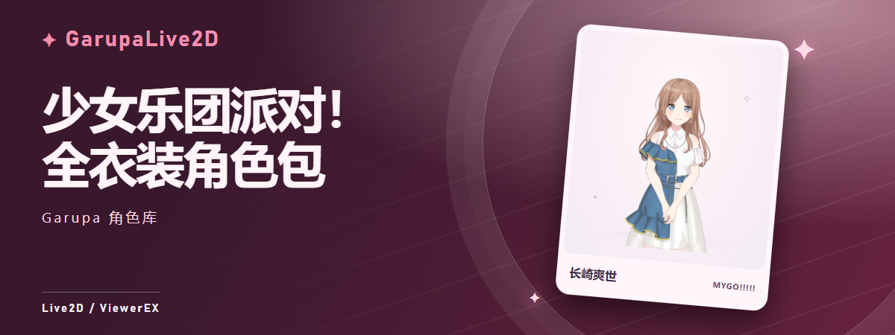
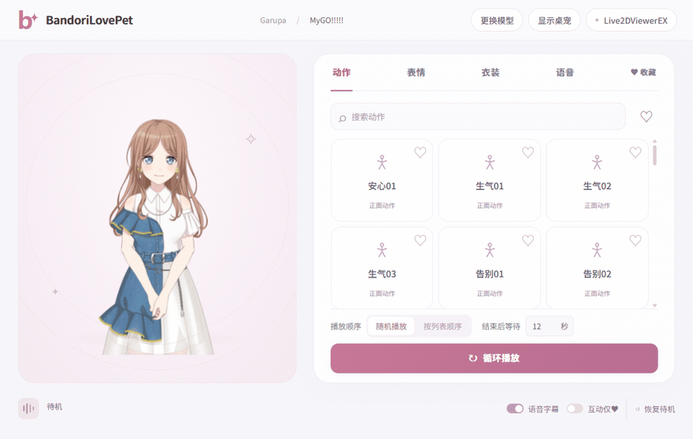

# GarupaLive2D

《BanG Dream! 少女乐团派对！》Live2D 角色库。收录 Poppin’Party、Roselia、Pastel＊Palettes 等乐团，以及 MyGO!!!!! 和 Ave Mujica 的 Garupa 版本。衣装、动作、表情与语音按角色整合。

**[挑选角色 ZIP](https://github.com/jiangyunxi222/GarupaLive2D/releases/latest)** · [下载示例 · 长崎爽世](https://github.com/jiangyunxi222/GarupaLive2D/releases/download/V261116/garupa_Soyo_Nagasaki_V261116.zip) · [Steam 创意工坊 · 长崎爽世](https://steamcommunity.com/sharedfiles/filedetails/?id=3838812468) · [获取 BandoriLovePet](https://github.com/jiangyunxi222/BandoriLovePet/releases)

**V261116 提供 45 个单角色 ZIP。** 发布页按乐团排列，下载时选择 **Assets** 里带角色全名的 ZIP。

## 角色实录

*MyGO!!!!! · 长崎爽世（Garupa）· 动作与换装实录*

## 导入

### BandoriLovePet · Windows / Android

1. 在 BandoriLovePet 点「选择模型」，直接导入单角色 ZIP。
2. 在应用内预览，或点「显示桌宠」。Android 显示桌宠需授予浮窗权限。

Windows 也可导入解压后的 `00_integrated.model.json`。[BandoriLovePet 使用指南](https://github.com/jiangyunxi222/BandoriLovePet)

### Live2DViewerEX · Windows 本地导入

1. 解压 ZIP，保留完整角色目录，包括 `ControlPanel` 和 `assets`。
2. 首次使用或升级后，双击一次 `ControlPanel/EnableAutoStart.cmd`。
3. 在 Live2DViewerEX 导入 `00_integrated.model.json`。控制台会在后台启动。
4. 点击角色腿部，再点「打开面板」进入网页控制台。

控制台支持收藏与循环播放。可分别设置动作、语音和换装的顺序与间隔。语音页支持添加本地音频和字幕。[Live2DViewerEX](https://store.steampowered.com/app/616720/Live2DViewerEX/)

### Steam 创意工坊

在工坊订阅角色，再从 ViewerEX 的创意工坊列表加载。需要包内网页控制台时，请按上面的 Windows 本地导入流程操作。[工坊示例 · 长崎爽世](https://steamcommunity.com/sharedfiles/filedetails/?id=3838812468)

## 角色互动

| 点击位置 | 互动 |
| --- | --- |
| 头顶或刘海上部 | 切换表情 |
| 脸部下半部 | 播放随机语音，可显示字幕 |
| 上身中央 | 播放普通动作 |
| 屏幕右侧 / 左侧手臂 | 播放角色左臂 / 右臂动作 |
| 腰部或衣服中段 | 随机换装 |
| 腿部或衣服下段 | 打开菜单 |

头像形态的上身、腰部和腿部触控区位于头像下方。语音与字幕以各角色包为准，来源见 `assets/voices/voice-sources.json`。

## 导入排查

- **ZIP 无法导入**。请下载发布页 Assets 中的单角色 ZIP。`Source code (zip)` 是仓库快照。
- **腿部菜单打不开**。运行 `EnableAutoStart.cmd`，再完整重载 `00_integrated.model.json`。
- **控制台提示启动 ViewerEX**。先在 ViewerEX 加载角色。独立安装未被识别时，将安装路径写入 `ControlPanel/viewer-path.txt`，再重启控制台。

## 角色图鉴

展开全部角色与衣装数量

以下为仓库收录的角色和衣装。可直接下载的单角色 ZIP 见 [角色发布页](https://github.com/jiangyunxi222/GarupaLive2D/releases/latest)。

| 团体 | 角色 | 衣装数 | 整合入口 |
| Afterglow | 上原绯玛丽 | 109 | [导入入口](<Afterglow/上原绯玛丽/00_integrated.model.json>) |
| Afterglow | 宇田川巴 | 113 | [导入入口](<Afterglow/宇田川巴/00_integrated.model.json>) |
| Afterglow | 美竹兰 | 111 | [导入入口](<Afterglow/美竹兰/00_integrated.model.json>) |
| Afterglow | 羽泽鸫 | 108 | [导入入口](<Afterglow/羽泽鸫/00_integrated.model.json>) |
| Afterglow | 青叶摩卡 | 104 | [导入入口](<Afterglow/青叶摩卡/00_integrated.model.json>) |
| Ave Mujica（Garupa） | 三角初华 | 6 | [导入入口](<Ave Mujica（Garupa）/三角初华（Garupa）/00_integrated.model.json>) |
| Ave Mujica（Garupa） | 丰川祥子 | 5 | [导入入口](<Ave Mujica（Garupa）/丰川祥子（Garupa）/00_integrated.model.json>) |
| Ave Mujica（Garupa） | 八幡海铃 | 4 | [导入入口](<Ave Mujica（Garupa）/八幡海铃（Garupa）/00_integrated.model.json>) |
| Ave Mujica（Garupa） | 祐天寺若麦 | 2 | [导入入口](<Ave Mujica（Garupa）/祐天寺若麦（Garupa）/00_integrated.model.json>) |
| Ave Mujica（Garupa） | 若叶睦 | 4 | [导入入口](<Ave Mujica（Garupa）/若叶睦（Garupa）/00_integrated.model.json>) |
| Hello, Happy World! | 北泽育美 | 106 | [导入入口](<Hello, Happy World!/北泽育美/00_integrated.model.json>) |
| Hello, Happy World! | 奥泽美咲 | 120 | [导入入口](<Hello, Happy World!/奥泽美咲/00_integrated.model.json>) |
| Hello, Happy World! | 弦卷心 | 115 | [导入入口](<Hello, Happy World!/弦卷心/00_integrated.model.json>) |
| Hello, Happy World! | 松原花音 | 105 | [导入入口](<Hello, Happy World!/松原花音/00_integrated.model.json>) |
| Hello, Happy World! | 濑田薰 | 112 | [导入入口](<Hello, Happy World!/濑田薰/00_integrated.model.json>) |
| Morfonica | 二叶筑紫 | 63 | [导入入口](<Morfonica/二叶筑紫/00_integrated.model.json>) |
| Morfonica | 仓田真白 | 73 | [导入入口](<Morfonica/仓田真白/00_integrated.model.json>) |
| Morfonica | 八潮瑠唯 | 60 | [导入入口](<Morfonica/八潮瑠唯/00_integrated.model.json>) |
| Morfonica | 广町七深 | 64 | [导入入口](<Morfonica/广町七深/00_integrated.model.json>) |
| Morfonica | 桐谷透子 | 65 | [导入入口](<Morfonica/桐谷透子/00_integrated.model.json>) |
| MyGO!!!!!（Garupa） | 千早爱音 | 17 | [导入入口](<MyGO!!!!!（Garupa）/千早爱音（Garupa）/00_integrated.model.json>) |
| MyGO!!!!!（Garupa） | 椎名立希 | 18 | [导入入口](<MyGO!!!!!（Garupa）/椎名立希（Garupa）/00_integrated.model.json>) |
| MyGO!!!!!（Garupa） | 要乐奈 | 16 | [导入入口](<MyGO!!!!!（Garupa）/要乐奈（Garupa）/00_integrated.model.json>) |
| MyGO!!!!!（Garupa） | 长崎爽世 | 15 | [导入入口](<MyGO!!!!!（Garupa）/长崎素世（Garupa）/00_integrated.model.json>) |
| MyGO!!!!!（Garupa） | 高松灯 | 18 | [导入入口](<MyGO!!!!!（Garupa）/高松灯（Garupa）/00_integrated.model.json>) |
| Pastel＊Palettes | 丸山彩 | 120 | [导入入口](<Pastel＊Palettes/丸山彩/00_integrated.model.json>) |
| Pastel＊Palettes | 冰川日菜 | 112 | [导入入口](<Pastel＊Palettes/冰川日菜/00_integrated.model.json>) |
| Pastel＊Palettes | 大和麻弥 | 103 | [导入入口](<Pastel＊Palettes/大和麻弥/00_integrated.model.json>) |
| Pastel＊Palettes | 白鹭千圣 | 104 | [导入入口](<Pastel＊Palettes/白鹭千圣/00_integrated.model.json>) |
| Pastel＊Palettes | 若宫伊芙 | 110 | [导入入口](<Pastel＊Palettes/若宫伊芙/00_integrated.model.json>) |
| Poppin'Party | 山吹沙绫 | 102 | [导入入口](<Poppin'Party/山吹沙绫/00_integrated.model.json>) |
| Poppin'Party | 市谷有咲 | 114 | [导入入口](<Poppin'Party/市谷有咲/00_integrated.model.json>) |
| Poppin'Party | 户山香澄 | 121 | [导入入口](<Poppin'Party/户山香澄/00_integrated.model.json>) |
| Poppin'Party | 牛込里美 | 101 | [导入入口](<Poppin'Party/牛込里美/00_integrated.model.json>) |
| Poppin'Party | 花园多惠 | 104 | [导入入口](<Poppin'Party/花园多惠/00_integrated.model.json>) |
| RAISE A SUILEN | 佐藤益木（MASKING） | 53 | [导入入口](<RAISE A SUILEN/佐藤益木（MASKING）/00_integrated.model.json>) |
| RAISE A SUILEN | 和奏瑞依（LAYER） | 54 | [导入入口](<RAISE A SUILEN/和奏瑞依（LAYER）/00_integrated.model.json>) |
| RAISE A SUILEN | 朝日六花（LOCK） | 63 | [导入入口](<RAISE A SUILEN/朝日六花（LOCK）/00_integrated.model.json>) |
| RAISE A SUILEN | 珠手知由（CHU²） | 52 | [导入入口](<RAISE A SUILEN/珠手知由（CHU²）/00_integrated.model.json>) |
| RAISE A SUILEN | 鳰原令王那（PAREO） | 50 | [导入入口](<RAISE A SUILEN/鳰原令王那（PAREO）/00_integrated.model.json>) |
| Roselia | 今井莉莎 | 108 | [导入入口](<Roselia/今井莉莎/00_integrated.model.json>) |
| Roselia | 冰川纱夜 | 105 | [导入入口](<Roselia/冰川纱夜/00_integrated.model.json>) |
| Roselia | 凑友希那 | 105 | [导入入口](<Roselia/凑友希那/00_integrated.model.json>) |
| Roselia | 宇田川亚子 | 108 | [导入入口](<Roselia/宇田川亚子/00_integrated.model.json>) |
| Roselia | 白金燐子 | 103 | [导入入口](<Roselia/白金燐子/00_integrated.model.json>) |
| 其他角色 | 户山明日香 | 12 | [导入入口](<其他角色/户山明日香/00_integrated.model.json>) |
| 其他角色 | 纯田真奈 | 1 | [导入入口](<其他角色/纯田真奈（Garupa）/00_integrated.model.json>) |

## 相关项目

夢限大みゅーたいぷ、millsage 与 OurNotes 版本的角色衣装。[OurNotesLive2D](https://github.com/jiangyunxi222/OurNotesLive2D)

Windows 和 Android 独立桌宠。[BandoriLovePet](https://github.com/jiangyunxi222/BandoriLovePet)

同好制作。角色与游戏素材权利归原权利人。
